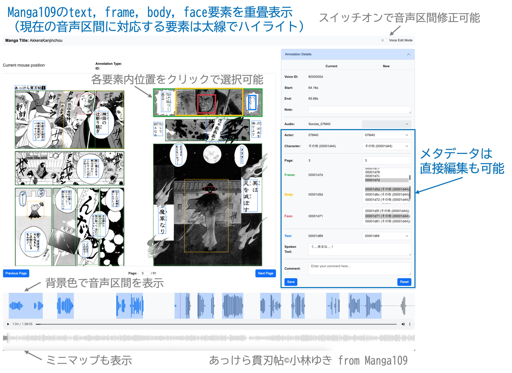
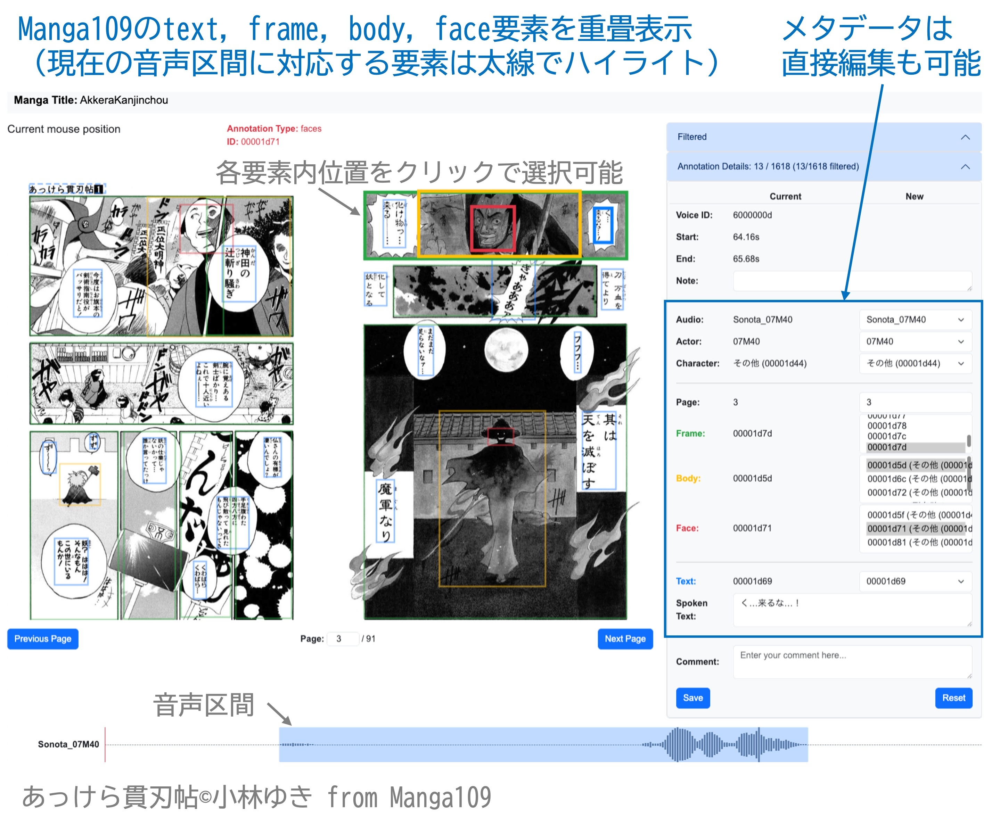

# MangaVox Annotation Tool

<p align="center">
  
</p>

<p align="center">
  <strong>Edit MangaVox voice annotations and align utterances with Manga109 page elements.</strong>
</p>

<p align="center">
  <strong>日本語</strong>
  ·
  <a href="./README_en.md">English</a>
</p>

<p align="center">
  <a href="https://github.com/TomohikoNakamura/mangavox_annotator/releases">
    
  </a>
  <a href="./LICENSE">
    
  </a>
  <a href="https://doi.org/10.1109/ICASSP55912.2026.11463396">
    
  </a>
  <a href="https://huggingface.co/datasets/imprt/mangavox_annotations">
    
  </a>
</p>

## 概要

**MangaVox Annotation Tool**は、MangaVoxの音声データに付与されたアノテーションを修正し、各発話をManga109の漫画画像上の要素と対応付けるためのブラウザベースのアノテーションツールです。

音声波形、漫画ページ、発話情報を同一画面上に表示し、以下の作業をインタラクティブに実施できます。

### 主な機能

- 音声アノテーションの修正
  - 発話の開始時刻および終了時刻の修正
  - 発話テキストの修正
  - キャラクタおよび演技者の修正
  - 音声ファイルIDの修正
- 発話と漫画要素の対応付け
  - `aligned_voice`要素と`frame, text, face, body`要素の対応付け
  - `aligned_voice`要素と漫画ページ番号の対応付け
- 2種類の音声表示モード
  - 作品全体の音声を扱う`full`モード
  - 発話単位の音声を扱う`utt`モード
- 編集履歴の保存と反映
  - 編集内容をYAML形式の変更ログとして保存
  - 変更ログに基づいてXMLアノテーションを更新
  - 更新前後の差分一覧を生成

> [!NOTE]
> 本リポジトリには、MangaVoxおよびManga109のデータは含まれていません。
> それぞれの配布元からデータを取得し、各データセットの利用条件に従って使用してください。

## 画面例

### 全体音声アノテーションモード（`full`モード）

作品全体の音声波形を表示し、発話区間を選択しながらアノテーションを編集します。

<p align="center">
  
</p>

### 発話単位音声アノテーションモード（`utt`モード）

発話単位の音声を切り替えながら、個別のアノテーションを編集します。

<p align="center">
  
</p>

## 必要条件

- Python 3.12以上
- [uv](https://docs.astral.sh/uv/)

## インストール

リポジトリをクローンし、uvを使用して実行環境を構築します。

```bash
git clone https://github.com/TomohikoNakamura/mangavox_annotator.git
cd mangavox_annotator
uv sync
```

## データの準備

本ツールを実行するには、Manga109の画像およびメタデータと、MangaVoxの音声およびメタデータが必要です。

### 1. Manga109の画像とメタデータを配置

Manga109の画像データを、作品ごとに以下のディレクトリへ配置します。

```text
data/manga109/Manga109_released_2023_12_07/images/<manga_title>
```

各作品のXMLメタデータを以下のパスへ配置します。

```text
data/manga109/Manga109_released_2023_12_07/annotations/<manga_title>.xml
```

### 2. MangaVoxの音声データを配置

発話単位の音声データを、作品ごとに以下のディレクトリへ配置します。

```text
data/manga2voice/concatenated_voices/<manga_title>
```

別のルートディレクトリを使用する場合は、後述するスクリプトの`--audio-root`オプションで指定できます。

### 3. MangaVoxの公開形式XMLを配置

`voice`要素を含むMangaVoxの公開形式XMLを、以下のパスへ配置します。

```text
data/workspace/<manga_title>.xml
```

例えば、作品名が`AkkeraKanjinchou`の場合は、次のパスになります。

```text
data/workspace/AkkeraKanjinchou.xml
```

### 4. 作品全体の混合音声を生成

`full`モードでは、作品内の各音声トラックを混合した音声ファイルを使用します。

`config.py`の`MANGA_TITLES`に含まれる全作品を処理する場合は、次のコマンドを実行します。

```bash
uv run python -m scripts.mix_mangavox_audio
```

入力音声が`concatenated_voices_v2`にある場合は、入力ルートを明示的に指定します。

```bash
uv run python -m scripts.mix_mangavox_audio \
  --audio-root data/manga2voice/concatenated_voices_v2 \
  --overwrite
```

混合音声は、以下のパスに生成されます。

```text
data/manga2voice/voices/<manga_title>_ALL.flac
```

混合処理には、以下の規則が適用されます。

- `*_Gaya.flac`はガヤ音声として扱われます。
- ガヤ音声は、通常はデフォルトで`-40 dB`まで減衰して混合されます。
- `config.py`の`GAYA_UTT_GAINS_IN_DB`に登録されたvoice ID区間については、区間の前後にマージンを加えた上で、指定されたゲインで混合されます。

### 5. MangaVoxとManga109のメタデータを結合

MangaVoxの公開形式XMLとManga109のXMLを結合し、アノテーションツール用のXMLを生成します。

`config.py`の`MANGA_TITLES`に含まれる全作品を処理する場合は、次のコマンドを実行します。

```bash
uv run python -m scripts.merge_with_manga109_annotations
```

生成されるXMLのファイル名は、原則として以下の形式です。

```text
data/workspace/<manga_title>_v1.xml
```

既存の`*_v1.xml`を上書きする場合は、`--overwrite`を指定します。

```bash
uv run python -m scripts.merge_with_manga109_annotations \
  --overwrite
```

一部の作品だけを処理する場合は、`--titles`に作品名を指定します。

```bash
uv run python -m scripts.merge_with_manga109_annotations \
  --titles AkkeraKanjinchou HinagikuKenzan
```

単一作品について入力ファイルと出力ファイルを直接指定する場合は、次のように実行します。

```bash
MANGA_TITLE="AkkeraKanjinchou"

uv run python -m scripts.merge_with_manga109_annotations \
  "data/workspace/${MANGA_TITLE}.xml" \
  "data/manga109/Manga109_released_2023_12_07/annotations/${MANGA_TITLE}.xml" \
  "data/workspace/${MANGA_TITLE}_v1.xml"
```

## アノテーションツールの起動

### 簡単起動スクリプトを使用する場合

次のBashスクリプトを実行します。

```bash
bash easy_launch.sh <mode> <manga_index>
```

引数には以下を指定します。

- `<mode>`
  - `full`：作品全体の混合音声を表示
  - `utt`：発話単位の音声を表示
- `<manga_index>`
  - 対象作品のインデックス番号

現在の作品インデックスは以下のとおりです。

| インデックス | 作品名                   |
| -----: | --------------------- |
|      1 | `AkkeraKanjinchou`    |
|      2 | `Akuhamu`             |
|      3 | `EverydayOsakanaChan` |
|      4 | `HinagikuKenzan`      |
|      5 | `LoveHina_vol01`      |
|      6 | `SaladDays_vol01`     |
|      7 | `TaiyouNiSmash`       |
|      8 | `YasasiiAkuma`        |

例えば、`AkkeraKanjinchou`を`full`モードで起動する場合は、次のように実行します。

```bash
bash easy_launch.sh full 1
```

### コマンドを直接実行する場合

基本的なコマンド形式は以下のとおりです。

```bash
uv run python launch.py \
  <mode> \
  --image_root <image_root> \
  <xml_path> \
  <audio_path>
```

各引数の意味は以下のとおりです。

| 引数             | 内容                      |
| -------------- | ----------------------- |
| `<mode>`       | `full`または`utt`          |
| `--image_root` | Manga109の漫画画像ディレクトリ     |
| `<xml_path>`   | アノテーション用XMLファイル         |
| `<audio_path>` | 音声ファイル、または発話単位音声のディレクトリ |

`<audio_path>`には、モードに応じて異なる形式を指定します。

- `full`モード
  - 作品全体の混合音声ファイル
  - 例：`data/manga2voice/voices/AkkeraKanjinchou_ALL.flac`
- `utt`モード
  - 発話単位音声を格納したディレクトリ
  - 例：`data/manga2voice/concatenated_voices/AkkeraKanjinchou`

#### `full`モードの実行例

```bash
MANGA_TITLE="AkkeraKanjinchou"

uv run python launch.py \
  full \
  --image_root "data/manga109/Manga109_released_2023_12_07/images/${MANGA_TITLE}" \
  "data/workspace/${MANGA_TITLE}_v1.xml" \
  "data/manga2voice/voices/${MANGA_TITLE}_ALL.flac"
```

#### `utt`モードの実行例

```bash
MANGA_TITLE="AkkeraKanjinchou"

uv run python launch.py \
  utt \
  --image_root "data/manga109/Manga109_released_2023_12_07/images/${MANGA_TITLE}" \
  "data/workspace/${MANGA_TITLE}_v1.xml" \
  "data/manga2voice/concatenated_voices/${MANGA_TITLE}"
```

### ブラウザからアクセス

サーバを起動した後、Webブラウザで以下のURLへアクセスします。

```text
http://localhost:8000
```

アノテーションの変更内容は、以下のディレクトリにログとして保存されます。

```text
logs/<mode>/<manga_title>
```

標準の変更ログファイルは以下です。

```text
logs/<mode>/<manga_title>/change_log.yaml
```

## アノテーションツールの操作

### キーボードおよびマウス操作

| 操作         | 機能                                        |
| ---------- | ----------------------------------------- |
| `Space`    | 音声の再生と一時停止を切り替える                          |
| `n`        | 次のリージョンを選択する                              |
| `b`        | 前のリージョンを選択する                              |
| `s`        | 選択中のリージョンに対する変更を保存する                      |
| `h`        | ヘルプの表示と非表示を切り替える                          |
| マウスホイール    | 波形をズームインまたはズームアウトする                       |
| 波形をクリック    | 現在のリージョン選択を解除する                           |
| リージョンをクリック | クリックしたリージョンを選択する                          |
| 漫画画像をクリック  | クリック位置を含む最小のバウンディングボックスを選択し、音声リージョンと対応付ける |

### 画面構成

#### 1. 波形パネル

- 音声波形と発話リージョンを表示します。
- キーボードまたはマウスで発話リージョンを選択できます。
- ズームスライダーで波形の表示解像度を調整できます。

#### 2. 漫画画像パネル

- Manga109の漫画ページを表示します。
- `frame`、`text`、`face`、`body`のバウンディングボックスを重ねて表示します。
- バウンディングボックスをクリックすると、選択中の音声リージョンと対応付けられます。

#### 3. アノテーションパネル

- 選択中の発話リージョンに付与された情報を表示します。
- 発話時刻、テキスト、キャラクタ、演技者、音声ファイルIDなどを編集できます。
- 編集内容の保存またはリセットを行えます。

### 基本的なアノテーション手順

1. 漫画画像、XMLアノテーション、音声データを読み込みます。
2. 波形上のリージョンをクリックするか、`n`キーまたは`b`キーで対象の発話を選択します。
3. 必要に応じて、発話の開始時刻、終了時刻、テキスト、キャラクタ、演技者などを編集します。
4. 漫画画像上のバウンディングボックスをクリックし、発話と漫画要素を対応付けます。
5. `s`キーまたは保存ボタンを使用して変更内容を保存します。
6. 編集内容は、以下の変更ログに記録されます。

```text
logs/<mode>/<manga_title>/change_log.yaml
```

## 変更ログに基づくXMLの更新

アノテーションツール上の編集内容は、元のXMLへ直接書き込まれません。編集完了後に、変更ログを使用して新しいXMLを生成します。

### XMLを更新

```bash
MODE="full"  # または "utt"
MANGA_TITLE="AkkeraKanjinchou"

uv run python -m scripts.update_mangavox_annotations \
  --change_log_dir "logs/${MODE}" \
  "data/workspace/${MANGA_TITLE}_v1.xml" \
  "data/workspace/${MANGA_TITLE}_v2.xml"
```

この例では、更新前の`*_v1.xml`から、更新後の`*_v2.xml`を生成します。

### 更新内容の一覧を生成

必要に応じて、更新前後のXMLを比較し、変更内容をYAML形式で出力できます。

```bash
MANGA_TITLE="AkkeraKanjinchou"

uv run python -m scripts.create_change_list \
  "data/workspace/${MANGA_TITLE}_v1.xml" \
  "data/workspace/${MANGA_TITLE}_v2.xml" \
  "data/workspace/${MANGA_TITLE}/change_log_v2-v1.yaml"
```

## 統計量の生成

Appendixに掲載する統計表を再生成する場合は、次のコマンドを実行します。

```bash
uv run python -m scripts.generate_annotation_stats \
  data/workspace/*_v2.xml \
  --audio-root data/manga2voice/concatenated_voices
```

## 引用

本ツールを研究で使用する場合は、以下の論文を引用してください。

```bibtex
@inproceedings{STakamichi2026ICASSP,
    author = "Takamichi, Shinnosuke and Nakamura, Tomohiko and Suda, Hitoshi and Fukayama, Satoru and Ogata, Jun",
    booktitle = "Proceedings of IEEE International Conference on Acoustics, Speech, and Signal Processing (ICASSP)",
    title = "MangaVox: {Dataset} of acted voices aligned with manga images towards computer understanding of audio comics",
    pages = "19467--19471",
    month = "May",
    year = "2026",
    doi = "10.1109/ICASSP55912.2026.11463396"
}
```

## ライセンス

本ツールのソースコードは、[MIT License](./LICENSE)の下で提供されます。

MangaVoxおよびManga109のデータには、本ツールとは異なる利用条件が適用されます。

- MangaVoxの音声およびメタデータは、MangaVoxの利用条件に従って使用してください。
- Manga109の画像およびメタデータは、Manga109の利用条件に従って使用してください。
- 本リポジトリのMIT Licenseは、MangaVoxおよびManga109のデータには適用されません。

## 謝辞
本ツールの開発は，産総研政策予算プロジェクト「フィジカル領域の生成AI基盤モデルに関する研究開発」の支援を受けて実施した．

# Appendix
## 発話要素の主な属性

`voice`および`aligned_voice`要素で使用される主な属性を以下に示します。

| 属性名             | 内容                   |  必須 | 値の例              |
| :-------------- | :------------------- | :-: | :--------------- |
| `id`            | 発話固有ID               |  ✓  | `60000027`       |
| `index`         | 発話順序インデックス           |  ✓  | `38`             |
| `start`         | 発話開始時刻 [s]           |  ✓  | `161.095`        |
| `end`           | 発話終了時刻 [s]           |  ✓  | `161.635`        |
| `episode_index` | 作品内の話数インデックス         |  ✓  | `1`              |
| `page_index`    | ページインデックス            |  ✓  | `4`              |
| `actor_id`      | 演技者ID                |  ✓  | `08F20`          |
| `character_id`  | キャラクタID              |  ✓  | `00001d7b`       |
| `audio_id`      | 音声ファイルID             |  ✓  | `08F20_Sakisuke` |
| `text_id`       | Manga109の`text`要素ID  |     | `00001d93`       |
| `frame_id`      | Manga109の`frame`要素ID |     | `00001d96`       |
| `face_id`       | Manga109の`face`要素ID  |     | `00001dc2`       |
| `body_id`       | Manga109の`body`要素ID  |     | `00001d94`       |
